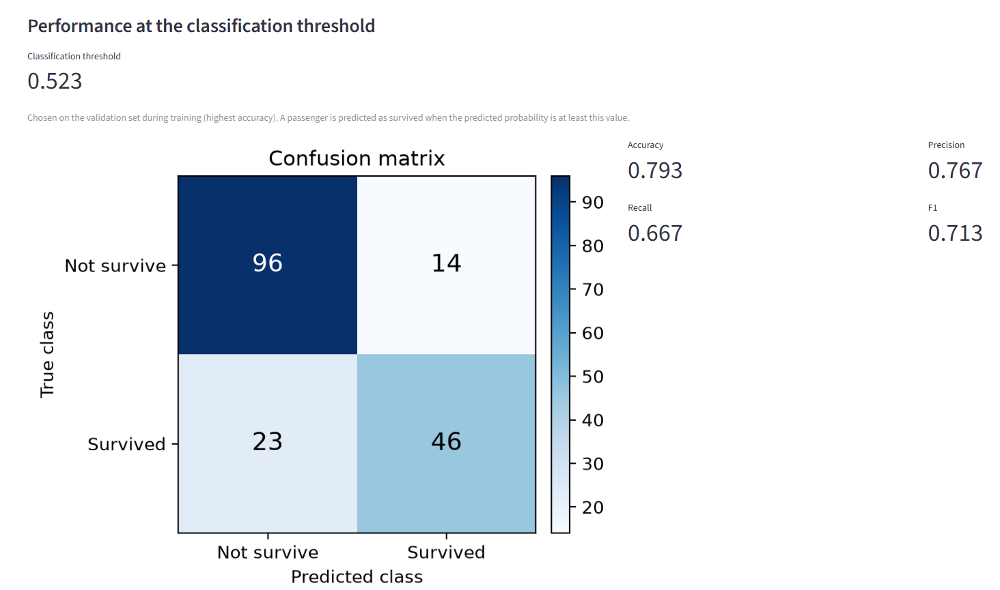

# Titanic Survival Prediction

An end-to-end classification pipeline that predicts Titanic passenger survival with a PyTorch neural network:
dataset download from Kaggle, exploratory data analysis, preprocessing, a standalone training script with
hyperparameter selection, and a Streamlit app for inference and evaluation.

Only Kaggle's `train.csv` is used.

---

## Results

<!-- TODO: fill in after the final training run (python train.py, then the app on data/test_set.csv). -->

Held-out test set (179 passengers), at the classification threshold saved with the model:

| ROC-AUC | PR-AUC | Accuracy | Precision | Recall | F1 |
| --- | --- | --- | --- | --- | --- |
| TBD | TBD | TBD | TBD | TBD | TBD |

---

## Quick start

```bash
git clone https://github.com/nivshifrin/titanic-survival-pytorch.git
cd titanic-survival-pytorch
python -m venv .venv
# Windows: .venv\Scripts\activate      macOS / Linux: source .venv/bin/activate
pip install -r requirements.txt

python train.py              # downloads the data from Kaggle, trains the model, saves it
streamlit run ds_app.py      # opens the app in the browser
```

A trained model (`models/titanic_mlp.pt`) and the held-out test set (`data/test_set.csv`) are included, so the app
can be opened right after installation. `python train.py` retrains the model from scratch and overwrites both files;
two runs produce identical weights.

### Requirements

- Python 3.11 or newer (tested with 3.12). Runs on CPU.
- On Linux, for a smaller CPU-only PyTorch, run
  `pip install torch==2.14.1 --index-url https://download.pytorch.org/whl/cpu` before installing the requirements.

### Kaggle credentials

`train.py` and `eda.ipynb` download `train.csv` from the
[Kaggle Titanic competition](https://www.kaggle.com/competitions/titanic/data) when `data/train.csv` is not present.
Kaggle requires, once:

1. An API token: on [kaggle.com/settings](https://www.kaggle.com/settings) → "API" → "Create New Token". Save
   `kaggle.json` as `~/.kaggle/kaggle.json` (Windows: `C:\Users\<you>\.kaggle\kaggle.json`), or set the environment
   variables `KAGGLE_USERNAME` and `KAGGLE_KEY`.
2. Accepting the competition rules on [kaggle.com/competitions/titanic/rules](https://www.kaggle.com/competitions/titanic/rules).

Alternatively, download `train.csv` by hand and place it at `data/train.csv`.

---

## How to run

| Command | What it does |
| --- | --- |
| `python train.py` | Downloads the data if needed, trains the model, writes `models/titanic_mlp.pt` and `data/test_set.csv` |
| `streamlit run ds_app.py` | Inference and evaluation on a CSV file |
| `jupyter notebook eda.ipynb` | The exploratory data analysis |
| `python hyperparameter_search/EXP_hyperparm.py` | The hyperparameter search (optional; results in `hyperparameter_search/results/`) |

### The app

1. Enter the path to a CSV file with the Kaggle Titanic columns, including `Survived`
   (default: `data/test_set.csv`, the held-out test set).
2. Click **Run evaluation**. The app loads the trained model from disk, runs inference and shows:
   - **Evaluated data:** number of passengers, survivors and non-survivors.
   - **Discrimination:** ROC-AUC and PR-AUC, with the ROC and precision-recall curves.
   - **Performance at the classification threshold:** the threshold, the confusion matrix, accuracy, precision,
     recall and F1.

Invalid input (missing file, missing columns, labels other than 0/1, no trained model) is reported in the app with a
short message saying how to fix it.




---

## Project structure

```
├── train.py                     Training script
├── ds_app.py                    Streamlit app
├── eda.ipynb                    Exploratory data analysis
├── requirements.txt
├── src/
│   ├── data_download.py         Downloads train.csv from Kaggle
│   ├── data_split.py            The shared train/test split
│   ├── preprocessing.py         TitanicPreprocessor (fit on training data, transform any data)
│   ├── model.py                 MLP, training loop, prediction, saving and loading
│   └── evaluation.py            Threshold selection, metrics and plots
├── hyperparameter_search/
│   ├── EXP_hyperparm.py         Cross-validated hyperparameter search
│   └── results/                 Search results (CSV)
├── data/
│   ├── train.csv                Downloaded from Kaggle at run time (not in the repository)
│   └── test_set.csv             Held-out test set, written by train.py
└── models/
    └── titanic_mlp.pt           Trained model, written by train.py
```

---

## Approach

### Data split

| Set | Size | Used for |
| --- | --- | --- |
| Training set | 80% of `train.csv` (712 rows) | EDA, hyperparameter search, training |
| ↳ `train_set` / `validation_set` | 80% / 20% of the training set | Fitting / early stopping and threshold choice |
| Test set | 20% of `train.csv` (179 rows) | Final evaluation in the app |

The test set (the assignment's "validation split") is split off before any analysis, so no decision is influenced
by it. All splits are stratified by `Survived` and seeded. One split function is shared by the notebook, training,
search and app, so all of them see exactly the same rows.

### EDA and preprocessing

`eda.ipynb` examines each group of columns and states the preprocessing decision for it:

| Column | Preprocessing | Reason |
| --- | --- | --- |
| `PassengerId` | Dropped | Identifier |
| `Name`, `Ticket` | Dropped | Almost every value is unique, so they cannot be used as they are |
| `Cabin` | Replaced by `Cabin_missing` (0/1) | Survival differs between rows where it is missing and present |
| `Age` | `Age_missing` (0/1) added; missing filled with the training median; standardized | Survival differs between rows where it is missing and present |
| `Fare` | `log1p`, then standardized | Strongly right-skewed |
| `Pclass`, `SibSp`, `Parch` | Numeric, standardized | |
| `Sex`, `Embarked` | One-hot encoded; missing `Embarked` filled with the training mode | |

Numeric inputs are standardized because a neural network trains better when inputs are on comparable scales.
The preprocessor (`src/preprocessing.py`) learns every value it uses (medians, mode, categories, means, standard
deviations) from `train_set` only and is saved inside the model file. No information leaks from validation or test
data, and any CSV is transformed exactly as in training.

### Model and training

A multilayer perceptron (`Linear → ReLU → Dropout` per hidden layer, one output logit), trained with Adam and
binary cross-entropy. Early stopping on the validation loss limits overfitting without using the test set; the
weights of the best epoch are kept. Everything is seeded.

### Hyperparameter search

`hyperparameter_search/EXP_hyperparm.py` compares 18 configurations — depth {1, 2} × width {16, 32, 64} ×
dropout {0, 0.2, 0.4} — with 5-fold cross-validation on the training set, because a single validation split of
~140 rows is too noisy to compare configurations. Each configuration is scored by ROC-AUC, which measures ranking
quality independently of the classification threshold, and the one with the highest mean AUC is selected.

Every run calls `fit_and_train()` from `train.py`, the same function the final training uses, so what is tuned is
exactly what is trained.

As a reference point for the results, a tree-based model (`HistGradientBoostingClassifier`, default settings) is
trained on the same folds with minimal preprocessing: only the raw numeric columns and `Sex` / `Embarked` as
categories, with missing values left to the model. A tree-based model was chosen because it suits tabular data.

### Classification threshold

The threshold that turns a probability into a class is chosen on `validation_set` during training (highest accuracy;
on a tie, the threshold that favours the majority class) and saved with the model. It is never tuned on the data
being evaluated.

---

## Possible extensions

The training set is small (712 rows). Combined or derived features — for example a passenger's title from `Name` or
family size from `SibSp` and `Parch` — are possible next steps that were not part of this work.
